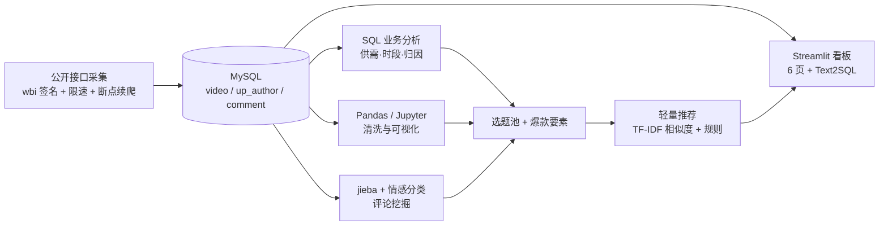

# B站知识区内容运营决策支持系统

> 面向内容运营「下周发什么」的决策支持项目：内容供需分析 → 爆款要素归因 → 评论需求挖掘 → 选题推荐与自助取数看板

<!-- TODO(你, 今晚): 把下面 3 行替换成你自己的话，一句话讲清"解决了谁的什么问题" -->
**一句话**：帮助知识区内容运营用数据决定**发什么选题、多长、什么时候发**。
**数据规模**：（待填）条视频 /（待填）条评论，采集于（待填）
**技术栈**：Python · MySQL · Pandas · Matplotlib/Seaborn · scikit-learn · Streamlit ·（可选）LLM

<!-- TODO(第12周后填): 核心结论摘要 —— 这是 README 最值钱的部分，面试官只看这里 -->
## 核心结论（TL;DR）

1. （待填）3 个供不应求的细分选题方向是 …
2. （待填）时长/时段的归因结论是 …
3. （待填）评论里用户最强烈的需求是 …
4. （待填）选题推荐 Top10 与自助取数看板（链接）

## 我要回答的 4 个业务问题

| # | 问题 | 模块 | 产出 |
|---|---|---|---|
| Q1 | 哪些细分选题供过于求 / 供不应求？ | 采集 + SQL 供需分析 | 供需热度矩阵 |
| Q2 | 什么内容组合（时长/时段/标题/体量）能拿到高播放高互动？ | SQL 分组对比 + 控制变量 | 爆款要素清单 |
| Q3 | 观众在弹幕与评论里要什么、骂什么？（弹幕=即时反应，评论=事后评价） | 弹幕/评论采集 + jieba + 情感分析 | 需求词表 + 选题池 |
| Q4 | 下周三条视频发什么、什么时候发？ | 轻量推荐 + 看板 + Text2SQL | 决策看板 |

## 架构



## 快速开始

```bash
# 1) 环境
python -m venv .venv && .venv\Scripts\activate     # Windows
pip install -r requirements.txt
python src/check.py                                # 环境自检，全绿再往下
python -m src.config                               # 确认关键词分组/分区/数据库配置读到了

# 1.5) 接口可行性（已实测通过，换分区时可重跑）
python reference/probe_endpoints.py                # 7 个接口逐个探测
python reference/probe_endpoints.py --map-tids     # 聚合二级分区 tid→名称

# 2) 配置
copy .env.example .env                             # 填数据库账号
# 编辑 config.yaml：关键词分组、采集上限

# 3) 采集 → 清洗 → 入库
python -m src.spider.search        # 待第6周实现
python -m src.clean
python -m src.db

# 4) 看板
streamlit run app/app.py           # 待第13周实现
```

## 目录

```
src/spider/  采集（wbi 签名、限速、断点续爬）
src/analyze/ 4 个业务问题各一个模块
src/nlp/     分词、情感、主题聚类
src/recsys/  轻量选题推荐
src/llm/     Text2SQL
sql/         12+ 条业务 SQL（每条带业务注释）
notebooks/   可复现分析报告
app/         Streamlit 看板
reports/     sql_report_v1 / analysis_report_v2
docs/        业务问题、指标口径、数据字典、偏差说明、踩坑记录、MySQL 安装指南
reference/   卡住时才看的参考实现 + 接口探测工具（probe_endpoints.py）
```

## 数据来源与合规声明

数据通过 B站 公开接口采集，**仅用于个人学习与研究**，不做商业用途、不二次分发原始数据、不绕过任何登录与付费限制；采集频率受限速控制（≥1.5s/请求）。分析对象为公开可见的视频元数据与评论内容。

## 已知局限

<!-- TODO(第12周填): 这是加分项，别省。至少写 4 条 -->
- 播放/点赞等为**快照值**，随时间增长，结论对应截面对发布时间
- 无曝光量与完播率（需后台数据），用时长×互动做代理
- 采集样本存在抽样偏差（仅覆盖部分关键词与分区）
- （待填）

## 许可

MIT（代码部分）。数据不随仓库分发。
