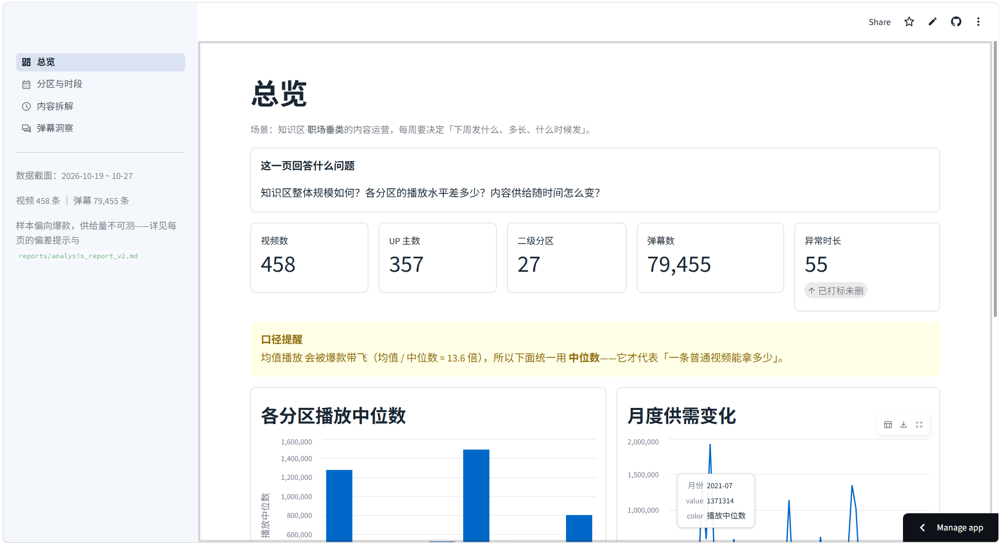
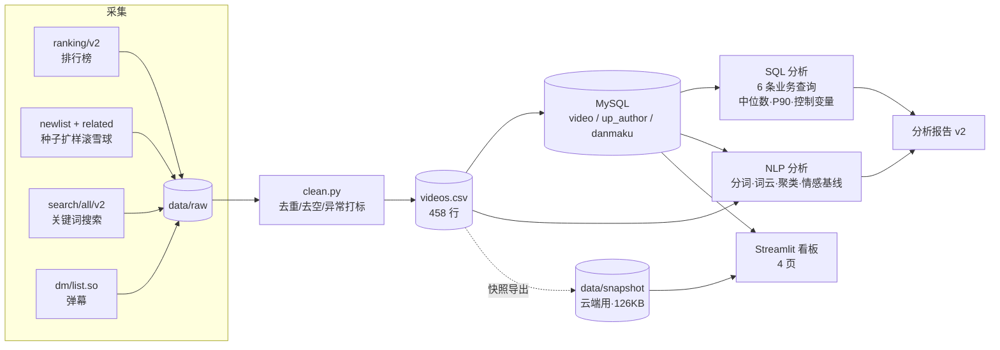

# B站知识区内容运营决策支持系统

> 内容供需分析 → 爆款要素归因 → 弹幕文本洞察 → 可交互决策看板
>
> **一句话**：帮知识区「职场垂类」的内容运营回答一个问题——**下周三条视频，发什么、多长、什么时候发。**

[](https://bilibili-knowledge-analytics-fhbyign7dte7ezoz978u7p.streamlit.app/)
[](https://www.python.org/)
[](https://www.mysql.com/)


---

## 核心结论（TL;DR）

> 这是本 README 最值钱的部分。完整推导见 [`reports/analysis_report_v2.md`](reports/analysis_report_v2.md)。

| # | 结论 | 关键数据 |
|---|---|---|
| 1 | **职场内容应做 8–15 分钟** | 职场内中位播放 46,597，是 3–8 分钟（20,554）的 **2.3 倍**；控制分区后，<3 分钟与 15–30 分钟的高点分别塌陷 **76% / 67%** |
| 2 | **"最优时长"是分区特定的，不可跨区推广** | 科学科普分区 <3 分钟中位播放 **151 万**（最高），Top10 中 6 条时长 <4 分钟——与职场结论完全相反 |
| 3 | **职业职场是知识区唯一「收藏 > 点赞」的细分** | 收藏率 3.39% / 点赞率 1.93%，比值 **1.75**；其他 6 个分区比值仅 0.41–0.93 |
| 4 | **求职流量横跨 4 个分区** | 「日常」与「计算机技术」的 Top10 **全部**是求职内容；只盯「职业职场」会漏掉一半 |
| 5 | **爆款 ≠ 高互动** | P75 阈值下，高播放·高互动仅 **18 条（5.2%）**；互动率分母（播放）涨得比分子快 |
| 6 | **职场用户是"沉默的工具型消费者"** | 三条独立证据：收藏>点赞（1.75）、弹幕密度仅为其他分区 **1/12**（117 vs 1,401 条/视频）、弹幕 **88% 中性** |
| 7 | **情感分析在本场景不可用** | snownlp 准确率 **27.0%**，而"全判中性"的多数类基线是 **88%**——比什么都不做还差 61 个百分点 |

**给运营的 5 条行动建议**：见 [`reports/analysis_report_v2.md` §5](reports/analysis_report_v2.md)

---

## 我回答的 4 个业务问题

| # | 业务问题 | 能否回答 | 方法 | 交付物 |
|---|---|---|---|---|
| **Q1** | 哪些细分选题供过于求 / 供不应求？ | ✅ 部分 | SQL 窗口函数算中位数 + P90 集中度 | [`sql/01`](sql/01_zone_supply_demand.sql) |
| **Q2** | 什么内容组合能拿高播放高互动？ | ✅ 部分 | SQL 分组对比 + **控制变量**（辛普森悖论检验） | [`sql/02`–`06`](sql/) |
| **Q3** | 观众在弹幕里要什么、骂什么？ | ✅ 部分 | jieba 分词 → TF-IDF+SVD+KMeans → 情感基线评估 | [`src/nlp/`](src/nlp/) |
| **Q4** | 下周三条发什么 | ❌ 未做 | 依赖更稳定的供给量数据源 | — |

> **"部分"是什么意思**：详见报告 §2。「能回答什么」和「不能回答什么、为什么」，我都写清楚了——**这比给出一个漂亮但站不住的结论更重要**。

---

## 数据规模与方法

| 项 | 内容 |
|---|---|
| 数据源 | B站 知识区公开接口（无需登录、不绕过任何限制） |
| 视频采集 | `ranking/v2`（95 条）+ `newlist`/`archive/related` 滚雪球（100 条）+ `search/all/v2` 关键词（264 条） |
| 弹幕采集 | `x/v1/dm/list.so`，**79,455 条 / 174 个视频** |
| 清洗后有效 | **403 条视频**（剔除 55 条 >3 小时直播回放/课程合集） |
| 覆盖 | 458 视频 / 357 UP 主 / 27 个二级分区 / 5 个求职关键词 |
| 数据截面 | 2026-10-19 ~ 2026-10-27（**快照值**） |
| 技术栈 | Python（requests / pandas / jieba / scikit-learn）→ MySQL 8.0.46 → SQL 窗口函数 → Streamlit |

**为什么全程用中位数不用均值**：播放量呈极端长尾（均值 50.7 万 vs 中位数 3.7 万，**差 13.6 倍**）。均值被个别爆款主导。

---

## 架构



**关键设计**：看板支持**双模式**——本地连 MySQL（实时），云端读 CSV 快照（部署用）。

---

## 看板

4 个页面：

| 页 | 内容 |
|---|---|
| **总览** | KPI 行 + 各分区播放中位数 + 月度供需趋势 |
| **分区与时段** | Q1 注意力集中度对比 + 星期×时段供给分布 + **"为什么这里没有时段建议"** |
| **内容拆解** | 时长 × 播放（全量 vs 控制分区可切换）+ 四象限散点 + 静态对比图 |
| **弹幕洞察** | 收藏率vs点赞率 + 弹幕密度 + 词云 + 主题聚类 + 时间轴 + 情感基线 |

> 每一页都带 **⚠️ 偏差提示**——告诉使用者这个数字**能怎么用、不能怎么用**。

---

## 快速开始

```bash
# 1) 环境
python -m venv .venv
.venv\Scripts\activate                      # Windows
pip install -r requirements.txt
python src/check.py                         # 环境自检（依赖/目录/MySQL/字体）

# 2) 配置
copy .env.example .env                      # 填数据库账号
# config.yaml 里可改关键词分组、分区 tid、采集上限

# 3) 采集（约 3 分钟，含限速）
python -m src.spider.search                 # 排行榜 95 条
python -m src.spider.search_kw              # 关键词搜索
python -m src.spider.crawl_zc               # 相关推荐滚雪球
python -m src.spider.fetch_cid              # 补 cid（弹幕接口需要）
python -m src.spider.fetch_danmaku          # 弹幕

# 4) 清洗 → 入库
python -m src.clean                         # 3 个 json → videos.csv
python -m src.db                            # csv → MySQL

# 5) 分析
python -m src.nlp.segment                   # 分词 + 词云
python -m src.nlp.cluster                   # 主题聚类
python -m src.nlp.sentiment                 # 情感基线 + 导出盲标样本
python -m src.nlp.timeline                  # 弹幕时间轴
python -m src.viz.make_figures              # 4 张报告图
python -m src.run_sql sql/01_zone_supply_demand.sql   # 跑任意 SQL 文件

# 6) 看板
python -m streamlit run app/app.py          # http://localhost:8501
```

---

## 目录

```
src/spider/     采集：wbi 签名、种子扩样、弹幕、cid 补采
src/nlp/        分词、词云、主题聚类、情感基线、弹幕时间轴
src/viz/        报告图表
src/clean.py    清洗（去重/HTML实体/时长异常打标）
src/db.py       入库（三段式：明细→拆表→批量写）
src/run_sql.py  跑 .sql 文件并打印表格
src/export_snapshot.py  导出云端快照

sql/            建表 + 6 条业务 SQL（每条带「业务问题/口径/结论/局限」文件头）
app/            Streamlit 看板（app.py 入口 + app_pages/ 4 页 + common.py 双模式数据层）
reports/        sql_report_v1（已被 v2 取代） / analysis_report_v2
docs/           业务问题 / 指标口径 / 数据字典 / 簇命名 / 踩坑记录 / 项目优化清单
figures/        7 张图（词云×2 / 时长对比 / 四象限 / 收藏点赞 / 集中度 / 时间轴）
data/snapshot/  云端快照（126KB，随仓库分发）
reference/      接口探测工具 + wbi 签名参考实现
```

---

## 已知局限（9 条，完整版见报告 §4）

1. **抽样强度不一致**：职业职场来自定向采集（滚雪球 + 5 关键词），科学科普来自排行榜——**分区间的"供给量"不可比**
2. **采集上限截断**：每词 ≤60 条；B站 `numResults` 统一封顶 1000 → **"供需比"口径不成立，已弃用**
3. **样本偏向爆款**：排行榜 Top95 + 搜索前几页，非随机样本
4. **字段缺失**：`coin_cnt` / `share_cnt` 为空，互动率只能用 (点赞+收藏)/播放
5. **异常阈值不彻底**：>180 分钟才标记，仍有 100–179 分钟长合集混入
6. **时间跨度 2019–2026**，年份未控制
7. **关键词仅 5 个**，不覆盖职场全部选题
8. **弹幕样本偏差**：首次按全局播放排序采，职场仅占 2.8%，已二次补采
9. **分区内噪声**：职业职场含 8.3% 装修施工类内容

> 本项目三次遇到"采集方式决定结论"的问题，每次都在分析前修正或声明。
> **拿到数据第一件事不是分析，是先问"这批数据是怎么来的、什么被排除了"。**

---

## 数据来源与合规

数据通过 B站 公开接口采集，**仅用于个人学习与研究**：不做商业用途、不二次分发原始数据、不绕过任何登录与付费限制；采集频率受限速控制（1.2–3s/请求），遇风控按退避阶梯等待而非重试轰炸。分析对象为公开可见的视频元数据与弹幕文本。

**原始数据不随仓库分发**（`data/raw/`、`data/processed/` 已 gitignore）；仓库内 `data/snapshot/` 仅含 458 行视频明细与聚合结果。

---

## 许可

代码部分 MIT。数据不随仓库分发。
